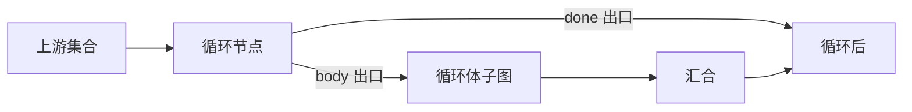

# 循环节点按编排设计思想重做

## 现状与问题

现有循环（[`CompositeWorkflowLoopConfig`](src/types/pages/ontologyCompositeWorkflowType.ts) + [`FunctionOperatorCompositeLogicNodeDialog`](src/views/FunctionOperatorPanel/components/FunctionOperatorCompositeLogicNodeDialog.vue)）与同画布控制/数据节点不一致：

| 维度     | 条件分支 / Switch / 转换                         | 当前循环                                 |
| -------- | ------------------------------------------------ | ---------------------------------------- |
| 上游取值 | 路径选择器（`upstreamParamPath`）                | 手填 `upstreamParamName` 或整段 JSON     |
| 图拓扑   | 多出口锚点 + 边标签（`branch` / `switchOutlet`） | 普通矩形单出口，串行「下一段都像循环体」 |
| 数据流   | 分支透传上游；转换有明确 outputs                 | 伪造 `{ item: object }`，无元素类型      |
| LiteFlow | `IF` / `SWITCH`                                  | 当普通组件串入，无 `FOR`                 |

设计思想对齐目标：**控制节点用出口表达结构，配置用上游路径绑定，数据流可解释，EL 可表达语义。**

## 目标语义（选定方案）

循环 = **对上游集合的 foreach 控制节点**（不引入 WHILE）：



- **body**：循环体内节点；下游「上游输出」为循环项 `item`（及可选 `index`）。
- **done**：循环结束后的路径；数据流与分支一致——**透传循环节点自身的上游输出**（不另造汇总结构）。
- 执行/EL：`FOR(loopId).DO(THEN(body…))`，再与 done 路径串行（汇合后接 done）。

## 配置模型

重写 [`CompositeWorkflowLoopConfig`](src/types/pages/ontologyCompositeWorkflowType.ts)：

```ts
{
  kind: "loop";
  collection: {
    mode: "fromUpstream";
    upstreamParamName: string;
    upstreamParamPath: string[];
  };
  itemParamName: string;      // 默认 "item"
  indexParamName?: string;    // 可选，默认不暴露
  maxIterations?: number;     // 安全上限，默认 100
}
```

- 默认集合改为 **fromUpstream**（与新建分支一致），去掉「手动 JSON 数组」主路径（历史 `manual` 在 `normalize` 时降级为空 fromUpstream，避免坏图）。
- 新增 [`compositeWorkflowLoopDefaults.ts`](src/views/FunctionOperatorPanel/utils/compositeWorkflowLoopDefaults.ts)：`createDefault` + `normalize`（对标 branchDefaults）。

## 画布与边

- 循环节点注册为与 **branch 同级的多锚点节点**（改 [`registerCompositeWorkflowNodes.ts`](src/views/FunctionOperatorPanel/utils/registerCompositeWorkflowNodes.ts)）：`_in`、`_out_body`、`_out_done`；UI 标注「循环体 / 结束后」。
- 边属性增加 `loopOutlet?: "body" | "done"`（[`CompositeWorkflowEdgePayload`](src/types/pages/ontologyCompositeWorkflowType.ts) + 画布连线时按锚点写入，对标 `branch`）。
- [`compositeWorkflowAnchors.ts`](src/views/FunctionOperatorPanel/utils/compositeWorkflowAnchors.ts)：识别 `_out_body` / `_out_done`。
- [`resolveCompositeWorkflowNodeUpstreamOutputs`](src/views/FunctionOperatorPanel/utils/compositeWorkflowGraph.ts)：
  - 经 **body** 入边：暴露 `[{ paramName: itemParamName, paramType: "object" }, …index?]`
  - 经 **done** 入边或其它：对循环节点 **继续递归透传**（同 branch/switch）

## 配置抽屉

[`FunctionOperatorCompositeLogicNodeDialog`](src/views/FunctionOperatorPanel/components/FunctionOperatorCompositeLogicNodeDialog.vue) 循环表单：

- 「集合（上游输出）」：与分支相同的 `el-select` + `upstreamOutputOptions` / pathKey
- 「单项变量名」「最大迭代次数」；可选「索引变量名」
- 去掉手动 JSON / 手填上游名

打开编辑时对 loop 也做 `normalizeCompositeWorkflowLoopConfig`（canvas 已对 branch/switch 做）。

## LiteFlow

[`compositeWorkflowLiteFlowEl.ts`](src/views/FunctionOperatorPanel/utils/compositeWorkflowLiteFlowEl.ts)：

- `kind === "loop"` → `emitLoop`：取 body / done 出边，生成 `FOR(id).DO(THEN(bodyExpr))`，再与 done 路径 `THEN` 拼接；缺 body 出警告。

## 涉及文件（实现时）

- 类型：`ontologyCompositeWorkflowType.ts`、`types/index.ts`（若导出变更）
- 工具：新增 loopDefaults；改 anchors、registerNodes、graph、liteFlowEl、canvas 连线/落点默认 config
- UI：LogicNodeDialog 循环表单
- 测试：扩展现有 composite workflow / liteflow 相关 `tests/*.test.mjs`（配置归一、锚点、EL、抽屉字段）

## 不在本期

- WHILE / 次数循环第二种模式
- 循环体结果自动聚合为新输出树（done 保持透传）
- 后端运行时实现（仅前端图模型 + EL 表达）

## 验证方式

- 更新/新增节点测试后 `npm test`（相关用例）
- `format:check`、`type-check`（区分既有失败）
- 人工：拖入循环 → 绑集合路径 → 从 body/done 连线 → 保存看 EL 含 `FOR(...).DO(...)`
