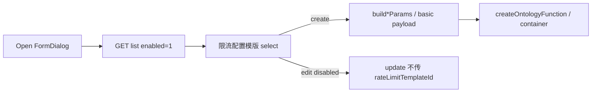

# 五类算子限流配置模版

## 需求理解

- 新建五类算子（basic / code / api / composite / docker）通用配置增加表单项「限流配置模版」。
- 选项来自已有 [`getListFunctionRateLimitTemplateInterface`](src/apis/functionRateLimitTemplateApi.ts)，请求 `enabled: 1`。
- 创建保存时带上 [`rateLimitTemplateId`](docs/20260923/6.createFunApi-shijian.md)（integer，非必填；未选则不传，走后端默认模板）。
- 编辑时该表单项禁用；更新请求不传该字段（契约：创建后不可修改）。

## 修改范围

- 类型与创建组装：统一创建 / 容器创建参数增加可选 `rateLimitTemplateId`。
- 表单 UI 与创建链路：五类通用配置 + builders + basic/script 保存。
- 详情可选回显：详情若返回该字段则编辑可展示；当前详情文档未声明时编辑为禁用空值亦可。
- 测试：builders / form / workspace 相关断言。
- 无新依赖；不改 `public/`、`html/`。

## 文件清单

**修改**

- [`src/types/apis/createOntologyFunctionType.ts`](src/types/apis/createOntologyFunctionType.ts) — `CreateOntologyFunctionParams.rateLimitTemplateId?: number`
- [`src/types/apis/createOntologyFunctionContainerType.ts`](src/types/apis/createOntologyFunctionContainerType.ts) — 容器创建参数同样增加可选字段
- [`src/types/pages/ontologyFunctionOperatorType.ts`](src/types/pages/ontologyFunctionOperatorType.ts) — `FunctionOperatorDraft.rateLimitTemplateId?: number`（表单绑定）
- [`src/types/apis/getOntologyFunctionDetailType.ts`](src/types/apis/getOntologyFunctionDetailType.ts) — 可选 `rateLimitTemplateId?: number`（编辑回显）
- 详情映射处（`mapOntologyFunction*` / FormDialog `toDraft`）— 有值则写入 draft
- [`src/views/FunctionOperatorPanel/components/FunctionOperatorFormDialog.vue`](src/views/FunctionOperatorPanel/components/FunctionOperatorFormDialog.vue) — 五类「通用配置」增加 `el-select`；打开弹窗拉模板列表；`:disabled="Boolean(operator)"`；创建组装传入 id
- [`src/views/FunctionOperatorPanel/utils/buildCreateOntologyScriptFunctionParams.ts`](src/views/FunctionOperatorPanel/utils/buildCreateOntologyScriptFunctionParams.ts)
- [`src/views/FunctionOperatorPanel/utils/buildCreateOntologyExternalFunctionParams.ts`](src/views/FunctionOperatorPanel/utils/buildCreateOntologyExternalFunctionParams.ts)
- [`src/views/FunctionOperatorPanel/utils/buildCreateOntologyFunctionContainerParams.ts`](src/views/FunctionOperatorPanel/utils/buildCreateOntologyFunctionContainerParams.ts)
- [`src/views/FunctionOperatorPanel/components/FunctionOperatorScriptIdeDialog.vue`](src/views/FunctionOperatorPanel/components/FunctionOperatorScriptIdeDialog.vue) — 创建入参透传
- [`src/views/FunctionOperatorPanel/composables/useFunctionOperatorWorkspace.ts`](src/views/FunctionOperatorPanel/composables/useFunctionOperatorWorkspace.ts) — basic 创建 payload；编排创建透传；**更新路径剥离** `rateLimitTemplateId`
- 相关 [`tests/*.test.mjs`](tests/)（script/external/container builders、create-ontology-function-api、function-operator-workspace 等）

**不改**

- 限流模板 CRUD API / 管理页（列表接口已存在）
- `UpdateOntologyFunctionParams` 不新增该字段

## 核心实现

1. **表单**：各类型「通用配置」在说明/版本附近增加一项；`clearable`；option `label=name`、`value=id`。
2. **加载**：弹窗打开时请求列表，失败 `ElMessage.error`，选项置空；loading 不影响其它字段编辑。
3. **创建**：有选中 id 才写入请求体；无则省略字段。
4. **编辑**：控件禁用；若详情带 `rateLimitTemplateId` 则回显；更新请求显式 omit（脚本路径与 `basedOnOldVersion` 同类处理）。

## 新增依赖

无。

## 验证方式

- 更新/新增相关 `tests/*.test.mjs`（TDD：先断言字段与 omit 行为，再实现）。
- `npm test`、`npm run test:coverage`
- `npm run type-check`、`npm run build:verify`
- `npm run format:check -- <本任务修改文件列表>`
- `git diff --check`、核对 `git status` 仅含本任务变更（保留用户已有无关改动，如 `docs/`、`domainConfig.js`）
