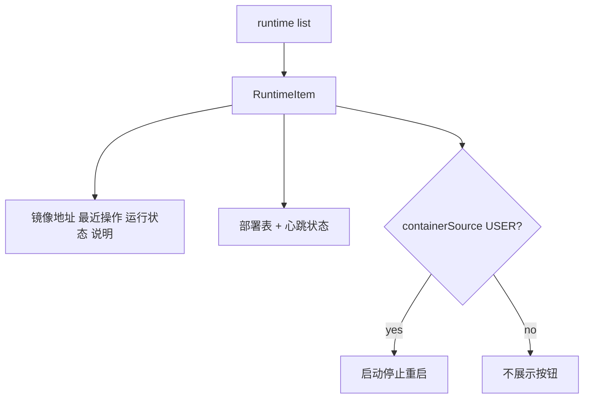

# 容器运行态列表新字段展示

## 需求理解

依据 [`docs/20261022/funContainerRuntimeListApi.md`](docs/20261022/funContainerRuntimeListApi.md) 新增字段，更新运行配置页展开区与按钮可见性：

- 生命周期区：**最近操作上方**展示「镜像地址」`imageAddress`
- 生命周期区：**说明上方**展示「运行状态」`phaseLabel`
- 部署信息表：新增「心跳状态」列（优先 `heartbeatLabel`，否则 `heartbeatStatus`，空为 `—`）
- `containerSource === "USER"` 时展示启动 / 停止 / 重启；否则不渲染这组按钮（phase 可用性逻辑仍保留）

## 修改范围

- 类型、列表 Mock、运行配置面板 UI、相关测试
- 无新依赖；不改 `public/`、`html/`

## 文件清单

**修改**

- [`src/types/apis/getOntologyFunctionContainerRuntimeListType.ts`](src/types/apis/getOntologyFunctionContainerRuntimeListType.ts) — 增加：
  - `imageAddress?: string`
  - `heartbeatStatus?: "HEALTHY" | "UNHEALTHY" | null`
  - `heartbeatLabel?: string | null`
  - `lastHeartbeatAt?: string | null`
  - `containerSource?: "USER" | "SYSTEM"`
  - `containerSourceLabel?: string`
- [`src/mocks/getOntologyFunctionContainerRuntimeListMock/getOntologyFunctionContainerRuntimeListMock.ts`](src/mocks/getOntologyFunctionContainerRuntimeListMock/getOntologyFunctionContainerRuntimeListMock.ts) — 样例补齐新字段（至少一条 `USER`、一条 `SYSTEM`）
- [`src/views/FunctionOperatorPanel/components/FunctionOperatorContainerRuntimePanel.vue`](src/views/FunctionOperatorPanel/components/FunctionOperatorContainerRuntimePanel.vue)：
  - lifecycle grid 顺序：`镜像地址` → `最近操作` → `运行状态` → `说明`
  - 部署表增加心跳状态列
  - `v-if="isUserManagedRuntime(row)"`（`containerSource === "USER"`）包裹启停重启按钮区
- [`tests/get-ontology-function-container-runtime-list-api.test.mjs`](tests/get-ontology-function-container-runtime-list-api.test.mjs) — 类型 / Mock / 面板断言

## 核心实现

`canStart/Stop/Restart` 不变；仅额外用 `containerSource === "USER"` 控制按钮是否出现。

## 新增依赖

无。

## 验证方式

- 更新并跑 `tests/get-ontology-function-container-runtime-list-api.test.mjs`
- `npm run type-check`、`npm run build:verify`
- `npm run format:check -- <本任务修改文件>`
- `git diff --check`；保留用户无关改动
