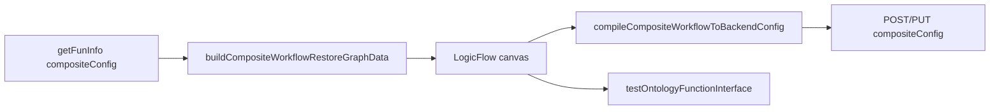

# 移植 hsbp 函数编排到当前项目

## 需求理解

以 [`dynamic-ontology-hsbp/`](dynamic-ontology-hsbp/)（已被 `.gitignore`）为源，把函数编排相对当前仓库的增量迁入，范围限定为：

1. 新增逻辑/端点节点（主要是 **开始 / 结束**）
2. 整体编排逻辑（多上游、校验、画布交互）
3. 编排传递参数（绑定含 `sourceNodeId` 等）
4. 保存与测试接口逻辑（后端契约编译 + `testOntologyFunctionInterface`）
5. 编辑回显（`buildCompositeWorkflowRestoreGraphData`）

**不移植**：限流模板管理页、容器运行态等与编排无关且当前已领先的能力。  
**须保留**：当前已有的 `rateLimitTemplateId` 创建透传（FormDialog `emitSaveComposite`）。

## 核心差异（源 vs 当前）

| 能力      | hsbp                                                                  | 当前                                            |
| --------- | --------------------------------------------------------------------- | ----------------------------------------------- |
| 起止节点  | `start` / `end` + Endpoint 弹框                                       | 无                                              |
| 保存 body | `compileCompositeWorkflowToBackendConfig` → `OntologyCompositeConfig` | `buildCompositeWorkflowSavePayload` 前端 schema |
| 编辑回显  | `buildCompositeWorkflowRestoreGraphData`（优先透传 `graph`）          | 直接按前端 SavePayload 回填                     |
| 测试      | 真实调用 `testOntologyFunctionInterface`                              | `notifyFeatureUnavailable`                      |
| 参数      | `sourceNodeId`、多上游输出合并；函数节点载荷 `functionId`             | 单前驱；`functionApi`                           |

## 修改范围与文件

**新增（从 hsbp 拷贝并适配）**

- [`src/types/apis/ontologyCompositeConfigType.ts`](src/types/apis/ontologyCompositeConfigType.ts)
- [`src/views/FunctionOperatorPanel/utils/compositeWorkflowBackendConfig.ts`](src/views/FunctionOperatorPanel/utils/compositeWorkflowBackendConfig.ts)（去掉源码中的 `console.log`）
- [`src/views/FunctionOperatorPanel/components/FunctionOperatorCompositeEndpointNodeDialog.vue`](src/views/FunctionOperatorPanel/components/FunctionOperatorCompositeEndpointNodeDialog.vue)
- [`tests/compositeWorkflowBackendConfig.test.mjs`](tests/compositeWorkflowBackendConfig.test.mjs)（自 hsbp）

**重点修改（以 hsbp 对应文件为基准合并）**

- [`src/types/pages/ontologyCompositeWorkflowType.ts`](src/types/pages/ontologyCompositeWorkflowType.ts)：`start`/`end`、`CompositeWorkflowEndpointNodePayload`、`sourceNodeId`、Dnd 载荷
- [`src/types/apis/createOntologyFunctionType.ts`](src/types/apis/createOntologyFunctionType.ts) / [`getOntologyFunctionDetailType.ts`](src/types/apis/getOntologyFunctionDetailType.ts) / [`ontologyFunctionOperatorType.ts`](src/types/pages/ontologyFunctionOperatorType.ts)：`compositeConfig` 改为 `OntologyCompositeConfig`（修正 hsbp 里运行时与类型不一致的问题）；**保留** `rateLimitTemplateId`
- [`registerCompositeWorkflowNodes.ts`](src/views/FunctionOperatorPanel/utils/registerCompositeWorkflowNodes.ts)：注册 start/end
- [`compositeWorkflowGraph.ts`](src/views/FunctionOperatorPanel/utils/compositeWorkflowGraph.ts)：多上游 + 校验对齐 hsbp
- [`useCompositeWorkflowCanvas.ts`](src/views/FunctionOperatorPanel/composables/useCompositeWorkflowCanvas.ts)：编译保存、回显 render、endpoint 编辑
- [`FunctionOperatorCompositeWorkflowDialog.vue`](src/views/FunctionOperatorPanel/components/FunctionOperatorCompositeWorkflowDialog.vue)：侧栏起止节点 + 真实测试
- 关联绑定 UI / Function 节点弹框（若 hsbp 含 `sourceNodeId` 选择）按 diff 合并
- 现有 `tests/composite-workflow-*.test.mjs` 断言随行为更新

**明确不覆盖**

- FormDialog / workspace 中限流、容器、EXTERNAL 等非编排改动
- `public/`、`html/`、`dynamic-ontology-hsbp/` 本身

## 核心实现方式

1. **类型**：引入后端契约类型；API/详情/草稿的 `compositeConfig` 统一为 `OntologyCompositeConfig`。
2. **节点**：侧栏增加开始/结束；画布注册与 Endpoint 弹框配置入出参与 end 绑定。
3. **参数流**：上游输出合并时写入 `sourceNodeId`；绑定 `fromUpstream` 可带 `sourceNodeId`。
4. **保存**：`buildCompositeWorkflowCreateParams` 改为 `compileCompositeWorkflowToBackendConfig`；FormDialog 继续附带 `rateLimitTemplateId`。
5. **测试**：移植 Dialog 内 `runTest`（JSON 校验 + `testOntologyFunctionInterface`）。
6. **回显**：初始化画布用 `buildCompositeWorkflowRestoreGraphData`；若历史数据仍是前端 `schemaVersion` SavePayload，在 restore 入口做薄适配（取 `graph.logicFlow` 作为透传图），避免旧草稿直接打不开。
7. **合并策略**：编排相关文件以 hsbp 为功能源，逐文件 diff 合入；非冲突处保留当前项目近期修复。

## 新增依赖

无（LogicFlow / 现有测试接口已具备）。

## 验证方式

- `node --test tests/composite*.test.mjs tests/compositeWorkflowBackendConfig.test.mjs`（及相关 form/workspace 编排断言）
- `npm run type-check`、`npm run build:verify`
- `npm run format:check -- <本任务修改文件>`
- `npm run check:types-conventions`（若动了 `src/types`）
- 人工冒烟：新建编排（起止+函数）保存、测试、再编辑回显；确认 SYSTEM/限流等无关功能未回退

## 风险

- `compositeConfig` 线格式变更后，仅存旧前端 SavePayload、且无可用 `logicFlow` 的数据可能需兜底重建。
- hsbp 与当前 canvas 行数差大，合并时禁止整目录覆盖，避免冲掉限流透传。
