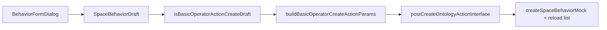

# 基础算子行为 createAction 对接

## 需求理解

在已有「基础函数算子」表单/草稿基础上，新建时调用 `POST /ontology/action`，按 [docs/20261103/createActionApi.md](docs/20261103/createActionApi.md) §3.4：

- `actionKind: "BASE"`，`subjectType: "BASIC_OPERATOR"`
- `functionApi` = 所选 BASIC_QUERY 的 api（即草稿 `functionOperatorId`）
- `outputMode: "RESULT_ONLY"`
- `ontologyIdentifier` / `categoryId` / `actionApi` / `displayName` / `description` 同通用字段
- `mappingIns`：每项 `functionParamId` + `parameterName` + `sourceType: "FIXED"` + `sourceConfig: <属性 apiName>`
- **不传** `operation`、`storageGroup`、`linkMapping`；mappingIns **不传** `propertyUniqueIdentifier`

**字段约定（按文档示例落地，请确认）**：加载函数详情时缓存 `paramName → paramId`；提交必传 `functionParamId`；详情缺 `paramId` 则拦截提示。若后端实际可只认 `parameterName`，确认 Plan 时说明即可改。

## 修改范围

- 扩展创建行为 API 类型，使 BASIC_OPERATOR 字段合法
- 草稿增加 `operatorParamIds`（paramName → paramId）
- 表单加载详情时写入 ids；组装器 + `createBehavior` 接入远程创建
- 单测覆盖组装与校验

## 新增 / 修改文件

- 修改 [src/types/apis/createOntologyActionType.ts](src/types/apis/createOntologyActionType.ts)
  - `CreateOntologyActionParams`：补 `functionApi?`、`outputMode?`；`operation` 改为可选（PROPERTY_VALUE/LINK 仍必填由组装器保证）
  - `CreateOntologyActionMappingIn`：补 `functionParamId?`；`propertyUniqueIdentifier` / `ontologyUniqueIdentifier` 改为可选（BASIC_OPERATOR 路径不传）
  - 增加 `CreateOntologyActionOutputMode = "RESULT_ONLY" | "WRITE_PROPERTY"`
- 修改 [src/types/pages/ontologySpaceBehaviorType.ts](src/types/pages/ontologySpaceBehaviorType.ts)：草稿增加 `operatorParamIds: Record<string, number>`
- 修改 [src/views/SpaceBehaviorWorkspace/components/BehaviorFormDialog.vue](src/views/SpaceBehaviorWorkspace/components/BehaviorFormDialog.vue)：详情加载时写入 `operatorParamIds`；`buildBehaviorDraft` 带出
- 修改 [src/views/ObjectBehaviorWorkspace/components/ObjectBehaviorFormDialog.vue](src/views/ObjectBehaviorWorkspace/components/ObjectBehaviorFormDialog.vue)：默认草稿补字段
- **新增** [src/views/SpaceBehaviorWorkspace/utils/buildBasicOperatorCreateActionParams.ts](src/views/SpaceBehaviorWorkspace/utils/buildBasicOperatorCreateActionParams.ts)
  - `isBasicOperatorActionCreateDraft`：`kind===basic && valueType===basicFunctionOperator`
  - `buildBasicOperatorCreateActionParams`：校验对象/算子/版本/绑定；mappingIns 按 `operatorParamBindings` 生成；缺 id 或空 apiName 返回 `{ error }`
- 修改 [src/views/SpaceBehaviorWorkspace/composables/useSpaceBehaviorWorkspace.ts](src/views/SpaceBehaviorWorkspace/composables/useSpaceBehaviorWorkspace.ts)：`createBehavior` 在现有 PROPERTY_VALUE/LINK 分支旁增加 BASIC_OPERATOR 远程创建（成功后仍 `createSpaceBehaviorMock` + `loadSpaceBehaviorWorkspace`，与现路径一致）
- 修改 [tests/ontology-space-behavior.test.mjs](tests/ontology-space-behavior.test.mjs)：组装成功/失败用例 + composable 引用断言

## 核心实现方式



请求体形状对齐文档示例：

```json
{
  "ontologyIdentifier": "<选中对象>",
  "categoryId": 14,
  "actionApi": "<行为api名称>",
  "displayName": "...",
  "actionKind": "BASE",
  "subjectType": "BASIC_OPERATOR",
  "functionApi": "<BASIC_QUERY api>",
  "outputMode": "RESULT_ONLY",
  "mappingIns": [
    {
      "functionParamId": 2292,
      "parameterName": "nm",
      "sourceType": "FIXED",
      "sourceConfig": "name"
    }
  ]
}
```

无绑定键时：省略 `mappingIns`（文档标为否必填）。

## 新增依赖

无

## 验证方式

- TDD：先写 `buildBasicOperatorCreateActionParams` 测试（期望失败）→ 实现 → 通过
- `node --test tests/ontology-space-behavior.test.mjs`
- `npm run format:check -- <本任务文件列表>`
- `npm run type-check`、`npm run build:verify`（既有无关失败单独注明）
- 人工：基础行为 → 行为类型=基础函数算子 → 选算子/对象/参数绑定 → 保存，抓包核对请求体
