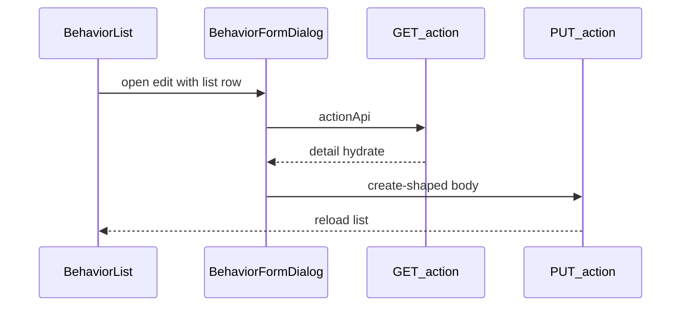

# 行为编辑：详情回显 + PUT 保存

## 需求理解

- 点「编辑」打开弹窗后，调用 `GET /ontology/action?actionApi=` 拉详情并回显。
- 点「保存行为」调用 `PUT /ontology/action`，body 与创建一致（靠 `actionApi` 定位；文档：编辑后 status 回 1）。
- 本轮覆盖与创建一致的三类：`PROPERTY_VALUE` / `LINK` / `BASIC_OPERATOR`。`APPLICATION` / 行为树不接 PUT（打开可提示暂不支持编辑保存）。

**UX 默认（与文档「编辑即重新发布」对齐）**：列表启用态（当前映射为 `published`）编辑时改为显示「保存行为」并走 PUT；去掉「仅另存草稿、禁止就地保存」限制。失效态仍只读。「另存草稿副本」本轮从启用态编辑页移除（避免与 PUT 主路径冲突）。

## 修改范围

- 新增详情 / 编辑 API 类型与接口函数
- Mock fixture（详情、编辑）
- 详情 → 表单状态映射；弹窗编辑打开时拉详情回显
- `updateBehavior` / 页面提交改为远程 PUT，成功后刷新列表
- 测试

## 新增 / 修改文件

- **新增** [src/types/apis/getOntologyActionInfoType.ts](src/types/apis/getOntologyActionInfoType.ts)：详情 `data` 类型（含 `mappingIns`、`linkMapping`、`functionParams` 等）
- **修改** [src/types/apis/createOntologyActionType.ts](src/types/apis/createOntologyActionType.ts) 或并列：`EditOntologyActionParams` 复用 `CreateOntologyActionParams`；`EditOntologyActionData = null`
- **修改** [src/types/index.ts](src/types/index.ts)、[src/apis/ontologyActionApi.ts](src/apis/ontologyActionApi.ts)、[src/apis/index.ts](src/apis/index.ts)
  - `getOntologyActionInfoInterface({ actionApi })`
  - `putEditOntologyActionInterface(params)` → `PUT /ontology/action`
- **新增 mock**：`src/mockData/fixtures/ontology/action/info.get.json`、`edit.put.json` + [src/mockData/routes.json](src/mockData/routes.json)（注意与已有 create POST `/ontology/action` 区分 method）
- **新增** [src/views/SpaceBehaviorWorkspace/utils/mapOntologyActionInfoToFormState.ts](src/views/SpaceBehaviorWorkspace/utils/mapOntologyActionInfoToFormState.ts)：详情 → 表单可回填结构
- **修改** [src/views/SpaceBehaviorWorkspace/components/BehaviorFormDialog.vue](src/views/SpaceBehaviorWorkspace/components/BehaviorFormDialog.vue)
  - 编辑打开：先列表项填基础字段，再按 `behaviorApiName` 拉详情；loading/error
  - 按 subjectType 回填对象/属性勾选与值、关系与时段、基础算子绑定（含 `operatorParamIds` / FIXED `sourceConfig`）
  - 启用态 footer：显示「保存行为」；`actionApi` 仍禁用
- **修改** [src/views/SpaceBehaviorWorkspace/composables/useSpaceBehaviorWorkspace.ts](src/views/SpaceBehaviorWorkspace/composables/useSpaceBehaviorWorkspace.ts) + [index.vue](src/views/SpaceBehaviorWorkspace/index.vue)
  - `updateBehavior`：对可组装的三类 draft 调 `putEditOntologyActionInterface`，成功后 `loadSpaceBehaviorWorkspace`；失败返回 message
- **修改** [tests/ontology-space-behavior.test.mjs](tests/ontology-space-behavior.test.mjs)

## 核心实现方式

详情回显要点：

| subjectType    | 回填                                                                            |
| -------------- | ------------------------------------------------------------------------------- |
| PROPERTY_VALUE | ontology、storageGroup、operation→basicAction、mappingIns→属性勾选/FIXED 值     |
| LINK           | ontology（源）、linkMapping→关系/状态/时段、operation                           |
| BASIC_OPERATOR | ontology、functionApi、mappingIns FIXED→operatorParamBindings + functionParamId |

保存：复用现有 `buildPropertyValueCreateActionParams` / `buildLinkCreateActionParams` / `buildBasicOperatorCreateActionParams`，改走 PUT。

## 新增依赖

无

## 验证方式

- 映射与 PUT 组装单测（TDD）
- `node --test tests/ontology-space-behavior.test.mjs`
- `format:check`、`type-check`、`build:verify`（既有无关失败单列）
- 人工：编辑三类行为 → 回显 → 保存抓包 PUT body
