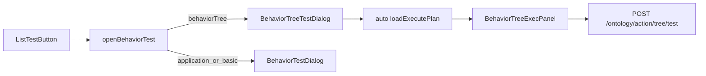

# 行为列表接入行为树执行

## 需求理解

- 图二行为列表中，对 `kind === "behaviorTree"` 的「测试」打开行为树执行 UI（黑板入参、节点实例、执行、结果、接口日志）。
- 与编排内区别：打开后**自动**调用「读取执行要求」（`GET /ontology/action` → `executeInputs`），无需先点按钮。
- **默认保留**编排弹窗「执行 / 日志」页签（两边共用同一套执行能力）；列表按钮文案仍为「测试」。
- 非 TREE 行为继续走现有 [`BehaviorTestDialog.vue`](src/views/SpaceBehaviorWorkspace/components/BehaviorTestDialog.vue)。

## 约束

[`src/views/readme.md`](src/views/readme.md) 禁止页面互引私有实现。因此必须把执行相关能力下沉到公共目录，供编排页与行为列表页共同引用。

## 修改范围

### 1. 下沉共享执行能力

从 [`BehaviorTreeOrchestration/`](src/views/BehaviorTreeOrchestration/) 迁出并改 `@/` 引用：

| 现位置                                    | 目标                                                                                                           |
| ----------------------------------------- | -------------------------------------------------------------------------------------------------------------- |
| `composables/useBehaviorTreeExecution.ts` | [`src/composables/useBehaviorTreeExecution.ts`](src/composables/useBehaviorTreeExecution.ts)                   |
| `components/BehaviorTreeExecPanel.vue`    | [`src/components/BehaviorTreeExecPanel.vue`](src/components/BehaviorTreeExecPanel.vue)（并按组件目录约定注册） |
| `utils/behaviorTreeExecutePlan.ts`        | [`src/utils/behaviorTreeExecutePlan.ts`](src/utils/behaviorTreeExecutePlan.ts)                                 |

仍留在编排页、由执行 composable 依赖的黑板/定义小工具（如 `behaviorTreeBlackboard`、`importBehaviorTreeDefinition`、对象目录加载）一并评估：若执行链路直接依赖，则一并下沉到 `src/utils/`；仅编排编辑用的保持原目录。

编排 Dialog 改为从 `@/composables`、`@/components`、`@/utils` 引用。

### 2. 列表侧 TREE 测试弹窗

新增 [`src/views/SpaceBehaviorWorkspace/components/BehaviorTreeTestDialog.vue`](src/views/SpaceBehaviorWorkspace/components/BehaviorTreeTestDialog.vue)：

- 入参：`spaceId`、`behavior`（TREE 行）、`v-model` 可见性。
- 内部：`useBehaviorTreeExecution` + `BehaviorTreeExecPanel`。
- 打开时：加载对象/属性目录（复用编排侧同等 API 映射逻辑，抽到共享 util/composable 若尚未可复用）→ **自动** `loadBehaviorTreeExecutePlan`；同一次详情响应用 `treeDefinition` 灌入本地 `BehaviorTreeModel.blackboard`，保证 EXTERNAL/PROPERTY 黑板区可渲染。
- UI：主按钮「执行」；「读取执行要求」保留作失败重试；提示文案改为列表场景（读库中已保存定义）。

### 3. 接线行为列表

- [`index.vue`](src/views/SpaceBehaviorWorkspace/index.vue) `openBehaviorTest`：`kind === "behaviorTree"` 时打开 `BehaviorTreeTestDialog`，不再被「仅支持应用/基础…」拦截。
- 挂载 `BehaviorTreeTestDialog`；应用/基础测试仍用 `BehaviorTestDialog`。

### 4. 测试与文档

- 更新 [`tests/ontology-space-behavior.test.mjs`](tests/ontology-space-behavior.test.mjs)：TREE 可测、接线 `BehaviorTreeTestDialog`、自动读执行要求。
- 更新编排相关 wiring 断言中的 import 路径（若有）。
- 补充 [`BehaviorTreeOrchestration/readme.md`](src/views/BehaviorTreeOrchestration/readme.md) 一句：执行面板已下沉，列表「测试」复用并自动读要求。

## 新增依赖

无。

## 验证方式

- TDD：先改/增失败断言（TREE 打开测试、自动 load-plan、共享路径），再实现。
- `node --test --experimental-strip-types tests/ontology-space-behavior.test.mjs`、`tests/behavior-tree-orchestration.test.mjs`
- 覆盖率按变更涉及可测 util；`format:check` 任务文件；`type-check`、`build:verify`；类型目录若有导出变更则 `check:types-conventions`。
